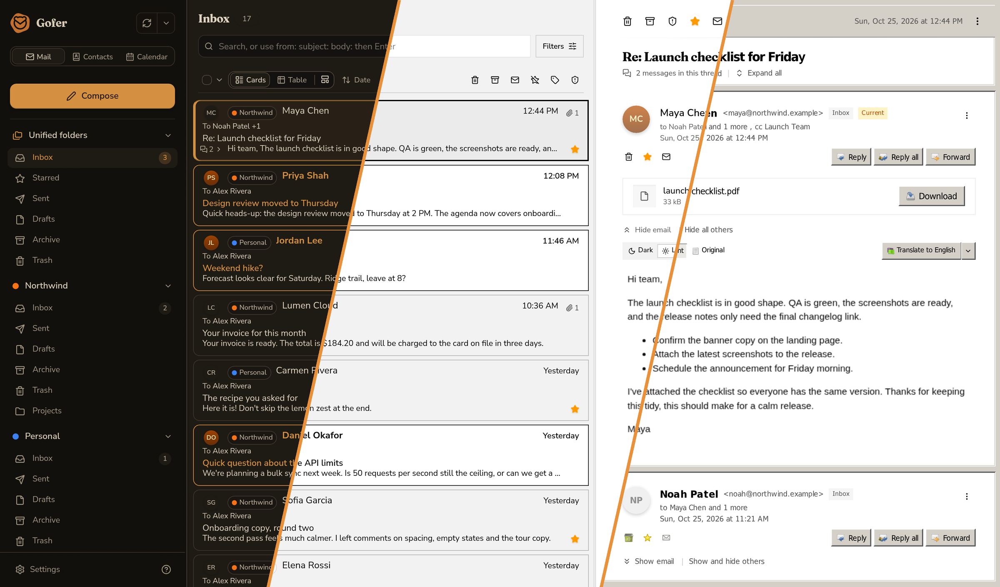

<p align="center">
  <b>English</b> · <a href="./README.zh-CN.md">简体中文</a>
</p>

<p align="center">
  
</p>

<h1 align="center">Gofer</h1>

<p align="center">
  A self-hosted home for your mail, contacts, and calendar.<br>
  <a href="https://github.com/cristianadrielbraun/gofer/releases">Download</a> ·
  <a href="./screenshots/README.md">Screenshots</a> ·
  <a href="./docs/setup.md">Setup guide</a>
</p>


<p align="center"><sub>Classic, Minimal, and Express, left to right</sub></p>

## why I'm building it

I wanted a webmail I'd enjoy using. I also wanted to host it myself and keep all my accounts in it. I couldn't find one that did all three, so I started writing Gofer.

It's a single Go binary with a SQLite database. Run it on your laptop or on a server and open it in a browser. Your Gmail, Outlook, iCloud and IMAP accounts share one inbox, with their contacts and calendars right there too.

I've used it every day for months, with six accounts and around 100k emails. It's pre-1.0 so things still change between versions. It holds up fine though.

## a quick tour

Gofer does mail, contacts and calendar. All your accounts land in one inbox. Contacts fill in as you type an address. Meeting invites show up in the email with buttons to answer them, and the event goes straight into your calendar.

### features

Rules, signatures, identities, a one-time From, scheduled send, translation, labels, threads (or no threads), cards or a table, multiple layouts (side by side, stacked, no reading pane at all), single-click open, drag and drop, right-click menus, a selection mode, search in one folder or one account or everywhere, search commands, Local folders, creating and renaming folders, folder roles, folder icons and colors, mbox import and export, moving mail between accounts, profile export, push notifications, the unread count in the tab title, printing, empty Trash in one click, sender pictures, blocked remote images, passkeys, authenticator apps (TOTP), three themes, a theme builder, a card layout editor, account ordering, English, Spanish, Brazilian Portuguese and Simplified Chinese (简体中文, with more languages to come), date and time formats, an installable Android app, a contacts Trash, creating calendars and address books, `.ics` import and export, calendar subscriptions, RSVP from the email, Meet and Teams links, dragging events around, month and week views, an update check on the About page, and probably a few more I'm forgetting.

### supported accounts

| | Mail | Contacts | Calendar | New mail | Signing in |
| --- | --- | --- | --- | --- | --- |
| **Gmail** | Gmail API | Google People API | Google Calendar API | scheduled checks for the whole account | your own OAuth app, for now |
| **Outlook** | Microsoft Graph | Microsoft Graph | Microsoft Graph | webhooks, or scheduled checks | sign in with Microsoft, nothing to set up |
| **iCloud** | IMAP/SMTP | CardDAV | CalDAV | IDLE, plus scheduled checks | app-specific password |
| **JMAP** (Fastmail, Stalwart…) | Gofer's JMAP client | Gofer's JMAP client | Gofer's JMAP client, or CalDAV | JMAP push (EventSource), plus scheduled checks | password or API token |
| **IMAP/SMTP** | [go-imap](https://github.com/emersion/go-imap) and [go-smtp](https://github.com/emersion/go-smtp) | CardDAV, if you have a server | CalDAV, if you have a server | IDLE, plus scheduled checks | password |

Outlook webhooks are off until you set `GOFER_OUTLOOK_WEBHOOKS=true`, and they need an install reachable over HTTPS ([details](./docs/setup.md#outlook-change-notifications)). IMAP servers that don't mark their Sent or Trash folders let you pick them yourself.

> [!NOTE]
> Without a mailbox, you can still add a CalDAV or CardDAV server as an account of its own, for calendars or contacts only. You can also subscribe to a calendar by its `.ics` link. It's read-only, and Gofer refreshes it as often as you choose, from every 15 minutes to once a day.

### make it yours

Gofer has three looks. Classic and Minimal are the sensible ones. Express is retro and my favorite. If none of them fit, the theme builder makes a new one to fit your taste, choosing primary and secondary colors, elements radius, and more. Folders can get their own icons and colors, and the mail cards can be rearranged. Gofer is in English, Spanish, Brazilian Portuguese and Simplified Chinese, and more languages are on the way.

On Android you can install it as an app.

### your data

Mailboxes export as mbox. You can also move a whole setup to another Gofer with a profile export. Passwords and tokens are encrypted on disk. Remote images stay blocked until you allow them. For sign-in there are passkeys and authenticator app codes (TOTP).

### for more than one person

There are three auth modes:

- **open**: no login at all, for a machine only you use
- **personal** (the default): one protected profile with all your accounts
- **managed**: several users, each with their own database and an admin panel. This mode is very much WiP. It does work but the usefulness of the admin panel is still green


## getting it running

**Binary.** Download one from the [releases page](https://github.com/cristianadrielbraun/gofer/releases) and start it. Then open `http://localhost:8090`. The terminal prints a setup token for the first sign-in.

**Docker.** There are images for amd64 and arm64 at `ghcr.io/cristianadrielbraun/gofer`. Set `GOFER_BASE_URL` in the example [`compose.yaml`](./compose.yaml), then:

```sh
docker compose up -d
docker compose logs gofer   # shows the first-run setup token
```

**Kubernetes.** There's a [Helm chart](./charts/gofer/README.md) for a single-replica install.

**From source.** You need Go 1.27.1+, `templ`, `tailwindcss`, and `task`:

```sh
task dev      # dev server with hot reload, at http://local.localhost:8090
task release  # self-contained binary at ./dist/gofer
```

Everything else, like reverse proxies and OAuth clients, is in [docs/setup.md](./docs/setup.md) and [`.env.example`](./.env.example).

> [!IMPORTANT]
> Back up your `data/` directory before upgrading. An older version can't open the database once a newer one has updated it.

## what's next

The big one is Gmail without your own OAuth app. I'd also like first-run setup to be easier. More shortcuts and more languages would be nice too. If something breaks or you're missing a feature, [open an issue](https://github.com/cristianadrielbraun/gofer/issues). I read them all.

## the stack

- [templ](https://templ.guide/) for Go-based views, with [templUI](https://templui.io/) components and [Lucide](https://lucide.dev/) icons
- [HTMX](https://htmx.org/) for server-driven interactions
- [Tailwind CSS](https://tailwindcss.com/) for styling
- [modernc.org/sqlite](https://pkg.go.dev/modernc.org/sqlite) for storage
- [emersion](https://github.com/emersion)'s Go libraries, [go-imap](https://github.com/emersion/go-imap), [go-smtp](https://github.com/emersion/go-smtp), [go-message](https://github.com/emersion/go-message), [go-sasl](https://github.com/emersion/go-sasl), [go-vcard](https://github.com/emersion/go-vcard), and [go-ical](https://github.com/emersion/go-ical), which carry much of the mail, contact, and calendar work
- [golang.org/x/oauth2](https://pkg.go.dev/golang.org/x/oauth2) for OAuth, [go-webauthn](https://github.com/go-webauthn/webauthn) for passkeys, and [webpush-go](https://github.com/SherClockHolmes/webpush-go) for push notifications

Gofer is [MIT licensed](./LICENSE).
