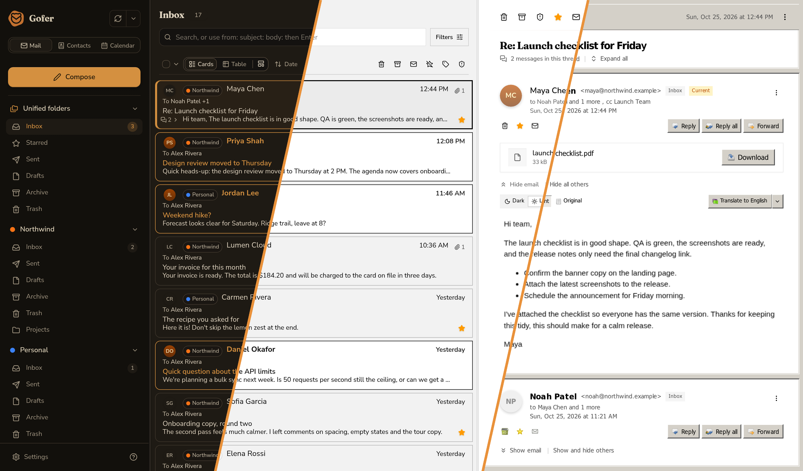

<p align="center">
  <a href="./README.md">English</a> · <b>简体中文</b>
</p>

<p align="center">
  
</p>

<h1 align="center">Gofer</h1>

<p align="center">
  为你的邮件、联系人和日历打造的自托管之家。<br>
  <a href="https://github.com/cristianadrielbraun/gofer/releases">下载</a> ·
  <a href="./screenshots/README.md">截图</a> ·
  <a href="./docs/setup.zh-CN.md">设置指南</a>
</p>


<p align="center"><sub>从左到右：经典（Classic）、极简（Minimal）和 Express</sub></p>

## 为什么要做它

我想要一个自己用起来顺手的网页邮箱，还想自己托管它，并把所有账户都放进去。我找不到能同时做到这三点的，于是开始写 Gofer。

它是一个 Go 二进制文件加一个 SQLite 数据库。你可以在笔记本电脑或服务器上运行它，然后在浏览器中打开。你的 Gmail、Outlook、iCloud 和 IMAP 账户共用一个收件箱，它们的联系人和日历也都在旁边。

我已经每天用了好几个月，挂着六个账户、大约 10 万封邮件。它还没到 1.0，所以不同版本之间还会有变化。不过用起来挺稳的。

## 快速一览

Gofer 包含邮件、联系人和日历。你的所有账户都汇集到同一个收件箱。输入地址时会自动补全联系人。会议邀请会直接显示在邮件中，并带有回复按钮，日程会直接进入你的日历。

### 功能

规则、签名、身份、一次性发件人、定时发送、翻译、标签、会话视图（也可以不分会话）、卡片或表格、多种布局（并排、堆叠，或者完全不要阅读窗格）、单击打开、拖放、右键菜单、选择模式、在单个文件夹或单个账户或全部范围内搜索、搜索命令、本地文件夹、创建和重命名文件夹、文件夹角色、文件夹图标和颜色、mbox 导入和导出、在账户之间移动邮件、配置文件导出、推送通知、标签页标题中的未读数、打印、一键清空回收站、发件人头像、默认屏蔽远程图片、通行密钥、双重验证（2FA）、三种主题、主题生成器、卡片布局编辑器、账户排序、英语、西班牙语、巴西葡萄牙语和简体中文（更多语言即将推出）、日期和时间格式、可安装的 Android 应用、联系人回收站、创建日历和通讯录、`.ics` 导入和导出、日历订阅、直接在邮件中回复会议邀请、Meet 和 Teams 链接、拖动日程、月视图和周视图、“关于”页面中的更新检查，可能还有一些我忘了的。

### 支持的账户

| | 邮件 | 联系人 | 日历 | 新邮件 | 登录方式 |
| --- | --- | --- | --- | --- | --- |
| **Gmail** | Gmail API | Google People API | Google Calendar API | 定时检查整个账户 | 暂时需要你自己的 OAuth 应用 |
| **Outlook** | Microsoft Graph | Microsoft Graph | Microsoft Graph | Webhook，或定时检查 | 使用 Microsoft 登录，无需任何设置 |
| **iCloud** | IMAP/SMTP | CardDAV | CalDAV | IDLE，外加定时检查 | App 专用密码 |
| **JMAP**（Fastmail、Stalwart…） | Gofer 的 JMAP 客户端 | Gofer 的 JMAP 客户端 | Gofer 的 JMAP 客户端，或 CalDAV | JMAP 推送（EventSource），外加定时检查 | 密码或 API 令牌 |
| **IMAP/SMTP** | [go-imap](https://github.com/emersion/go-imap) 和 [go-smtp](https://github.com/emersion/go-smtp) | CardDAV（如果你有服务器） | CalDAV（如果你有服务器） | IDLE，外加定时检查 | 密码 |

Outlook Webhook 默认关闭，需要设置 `GOFER_OUTLOOK_WEBHOOKS=true`，并且需要一个可以通过 HTTPS 访问的部署（[详情](./docs/setup.zh-CN.md#outlook-变更通知)）。如果 IMAP 服务器没有标记“已发送”或“回收站”文件夹，你可以自己选择。

> [!NOTE]
> 即使没有邮箱，你也可以把 CalDAV 或 CardDAV 服务器单独添加为一个账户，只用于日历或联系人。你还可以通过 `.ics` 链接订阅日历。订阅的日历是只读的，Gofer 会按你选择的频率刷新它，从每 15 分钟一次到每天一次不等。

### 按你的喜好定制

Gofer 有三种外观。经典（Classic）和极简（Minimal）是中规中矩的两种。Express 是复古风，也是我最喜欢的。如果都不合心意，主题生成器可以按你的品味做一个新的，你可以选择主色和次色、元素圆角等等。文件夹可以有自己的图标和颜色，邮件卡片也可以重新排列。Gofer 支持英语、西班牙语、巴西葡萄牙语和简体中文，更多语言正在路上。

在 Android 上，你可以把它安装为应用。

### 你的数据

邮箱可以导出为 mbox。你还可以通过配置文件导出，把整套设置迁移到另一个 Gofer。密码和令牌在磁盘上加密存储。远程图片在你允许之前会一直被屏蔽。登录方面支持通行密钥，以及通过身份验证器应用进行双重验证。

### 多人使用

有三种身份验证模式：

- **open**：完全不需要登录，适合只有你自己使用的机器
- **personal**（默认）：一个受保护的个人资料，包含你的所有账户
- **managed**：多个用户，每个用户都有自己的数据库，并提供管理面板。这个模式仍处于非常早期的开发阶段。它可以用，但管理面板的实用性还很初步

## 运行起来

**二进制文件。** 从 [releases 页面](https://github.com/cristianadrielbraun/gofer/releases)下载并启动，然后打开 `http://localhost:8090`。终端会打印首次登录所需的设置令牌。

**Docker。** `ghcr.io/cristianadrielbraun/gofer` 提供 amd64 和 arm64 镜像。在示例 [`compose.yaml`](./compose.yaml) 中设置 `GOFER_BASE_URL`，然后运行：

```sh
docker compose up -d
docker compose logs gofer   # 显示首次运行的设置令牌
```

**Kubernetes。** 有一个用于单副本部署的 [Helm chart](./charts/gofer/README.md)（英文）。

**从源码构建。** 你需要 Go 1.27.1+、`templ`、`tailwindcss` 和 `task`：

```sh
task dev      # 带热重载的开发服务器，地址为 http://local.localhost:8090
task release  # 自包含的二进制文件，输出到 ./dist/gofer
```

其他内容，比如反向代理和 OAuth 客户端，请参阅 [docs/setup.zh-CN.md](./docs/setup.zh-CN.md) 和 [`.env.example`](./.env.example)。

> [!IMPORTANT]
> 升级前请备份你的 `data/` 目录。数据库一旦被新版本更新，旧版本就无法再打开它。

## 接下来

最重要的一项是让 Gmail 不再需要你自己的 OAuth 应用。我也希望首次运行的设置能更简单。更多快捷键和更多语言也会很不错。如果有东西坏了，或者你缺少某个功能，请[提交 issue](https://github.com/cristianadrielbraun/gofer/issues)。每一条我都会看。

## 技术栈

- [templ](https://templ.guide/)：基于 Go 的视图，搭配 [templUI](https://templui.io/) 组件和 [Lucide](https://lucide.dev/) 图标
- [HTMX](https://htmx.org/)：服务端驱动的交互
- [Tailwind CSS](https://tailwindcss.com/)：样式
- [modernc.org/sqlite](https://pkg.go.dev/modernc.org/sqlite)：存储
- [emersion](https://github.com/emersion) 的 Go 库：[go-imap](https://github.com/emersion/go-imap)、[go-smtp](https://github.com/emersion/go-smtp)、[go-message](https://github.com/emersion/go-message)、[go-sasl](https://github.com/emersion/go-sasl)、[go-vcard](https://github.com/emersion/go-vcard) 和 [go-ical](https://github.com/emersion/go-ical)，承担了邮件、联系人和日历的大部分工作
- [golang.org/x/oauth2](https://pkg.go.dev/golang.org/x/oauth2) 用于 OAuth，[go-webauthn](https://github.com/go-webauthn/webauthn) 用于通行密钥，[webpush-go](https://github.com/SherClockHolmes/webpush-go) 用于推送通知

Gofer 采用 [MIT 许可证](./LICENSE)。
